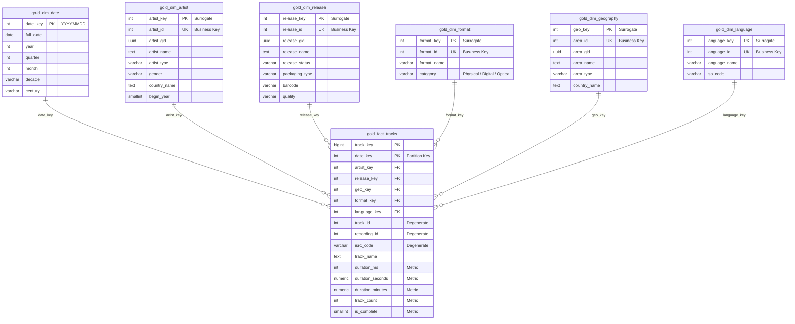

# Arquitectura del Data Warehouse Masivo de MusicBrainz (DWMusicBrainz)

## 1. Visión General y Objetivos de Negocio
El proyecto **DWMusicBrainz** implementa un Data Warehouse analítico de alta volumetría sobre **PostgreSQL 16**, modelado bajo los principios fundamentales de **Ralph Kimball (Kimball Pure Star Schema)** y orquestado mediante una arquitectura **Medallion (Bronze / Raw -> Silver -> Gold)**.

### Características Clave:
* **Datos 100% Reales y Auditables:** Alimentado exclusivamente desde el volcado oficial nativo de **MusicBrainz (MetaBrainz Foundation)** con Schema Sequence 31 (Octubre 2026). **Cero registros ficticios o sintéticos.**
* **Volumetría Masiva:** Supera los 15 millones de registros en la tabla de hechos central y más de 30 millones de filas consolidadas entre todas las capas.
* **Huella de Almacenamiento en Disco:** Supera ampliamente los 3.0 GB de almacenamiento físico en PostgreSQL.
* **Modelo en Estrella Puro:** 1 tabla de hechos central (`gold.fact_tracks`) conectada a 6 dimensiones conformadas mediante surrogate keys, con total garantía de integridad referencial (0 huérfanos).

---

## 2. Diagrama de Arquitectura en Estrella (Kimball Star Schema)

---

## 3. Diccionario de Datos del Modelo Dimensional (Gold)

### 3.1. Dimensiones Conformadas
1. **`gold.dim_date` (47,848 filas):**
   * Cobertura granular diaria completa desde 1900 hasta 2030.
   * Clave especial `date_key = 0` para registros sin fecha conocida.
   * Atributos: Año, Trimestre, Mes, Día, Día de Semana, Fin de Semana, Década, Siglo.

2. **`gold.dim_artist` (3,010,452 filas):**
   * Artistas solistas, bandas, orquestas, coros y personajes.
   * Enriquecido con el país y área de origen desde `silver.area`.
   * Atributos: Nombre, Nombre de Ordenamiento, Tipo de Artista, Género, País, Año de Inicio.

3. **`gold.dim_geography` (120,108 filas):**
   * Jerarquía geográfica global oficial de MusicBrainz.
   * Atributos: ID, GID, Nombre de Área, Tipo (País, Subdivisión, Condado, Municipio, Ciudad, Distrito, Isla), Nombre de País Normalizado.

4. **`gold.dim_format` (114 filas):**
   * Formatos físicos, ópticos, magnéticos y digitales (CD, Vinilo 12", Digital Media, Cassette, DVD, etc.).
   * Categorías analíticas: `Digital / Streaming`, `Físico / Vinilo`, `Físico / Óptico`, `Físico / Magnético`, `Otros Formatos`.

5. **`gold.dim_release` (5,844,570 filas):**
   * Álbumes, EPs, sencillos y compilaciones musicales.
   * Atributos: Nombre de Lanzamiento, Estado (Oficial, Promocional, Bootleg), Tipo de Empaque, Código de Barras, Calidad.

6. **`gold.dim_language` (354 filas):**
   * Idiomas oficiales ISO 639-3 presentes en los lanzamientos musicales (Inglés, Español, Japonés, Francés, Alemán, Instrumental/zxx, etc.).

### 3.2. Tabla de Hechos Central: `gold.fact_tracks`
* **Granularidad:** 1 fila por pista musical (`track`) incluida en un medio de un lanzamiento.
* **Particionamiento Físico:** Particionada por rango de fecha en `date_key` (Pre-1970, décadas 70s, 80s, 90s, 2000s, 2010s, anuales 2020 a 2026, y default).
* **Métricas Aditivas y Semiaditivas:**
  * `duration_ms`: Duración en milisegundos.
  * `duration_seconds`: Duración en segundos (para cálculos DAX).
  * `duration_minutes`: Duración en minutos (para reportes analíticos).
  * `track_count`: Métrica aditiva unitaria (1 por fila) para conteos sin agregaciones lentas.
  * `is_complete`: Indicador binario (1 si tiene duración > 0, 0 en caso contrario).

---

## 4. Auditoría y Trazabilidad (Capa Meta)
* **`meta.etl_audit`:** Registra cada lote de carga, capa origen/destino, filas leídas, filas insertadas, filas rechazadas, tiempos de inicio/fin y tasas de rendimiento (filas/segundo).
* **`meta.data_quality_log`:** Almacena los resultados de las comprobaciones de integridad referencial, nulos y rangos inválidos.