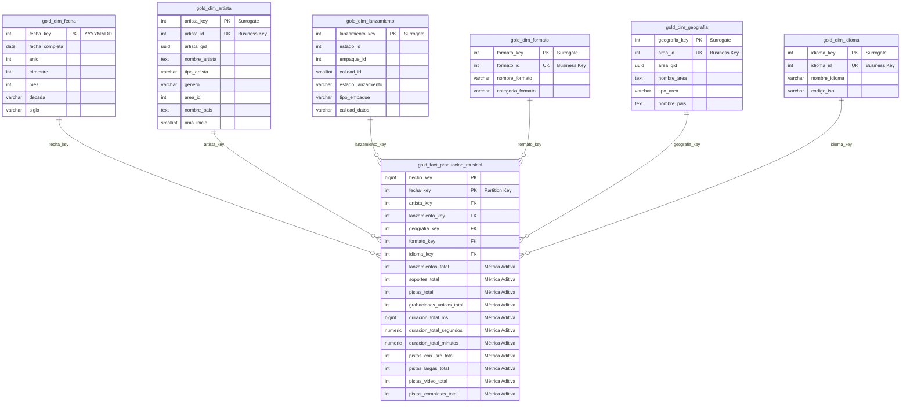

# Arquitectura del Data Warehouse Masivo de MusicBrainz (`DWMusicBrainz`)

## 1. Visión General y Objetivos de Negocio
El proyecto **DWMusicBrainz** implementa un Data Warehouse analítico de alta volumetría sobre **PostgreSQL 16**, modelado bajo los principios fundamentales de **Ralph Kimball (Kimball Pure Star Schema)** con nomenclatura de negocio en español y orquestado mediante una arquitectura **Medallion (Raw -> Silver -> Gold)**.

### Características Clave:
* **Datos 100% Reales y Auditables:** Alimentado exclusivamente desde el volcado oficial nativo de **MusicBrainz (MetaBrainz Foundation)** con Schema Sequence 31 (Octubre 2026). **Cero registros ficticios o sintéticos.**
* **Tabla de Hechos Histórica con Grano Diario:** Consolida la historia diaria de lanzamientos y producción musical mediante claves foráneas conformadas y **métricas numéricas 100% aditivas** (cero columnas de texto y cero booleanos en la tabla de hechos).
* **Fechas y Artistas Históricos Reales:** Extrae las fechas reales de publicación por país desde `silver.release_country` y `silver.release_unknown_country`, y resuelve la autoría real mediante `silver.artist_credit_name`.
* **Modelo en Estrella Puro en Español:** 1 tabla de hechos central (`gold.fact_produccion_musical`) conectada a 6 dimensiones conformadas (`dim_fecha`, `dim_artista`, `dim_lanzamiento`, `dim_geografia`, `dim_formato`, `dim_idioma`) mediante surrogate keys con patrón de **Fila Cero (`Key 0`)** (0 huérfanos).

---

## 2. Diagrama de Arquitectura en Estrella (Kimball Star Schema)

---

## 3. Diccionario de Datos del Modelo Dimensional (Gold)

### 3.1. Dimensiones Conformadas
1. **`gold.dim_fecha` (47.848 filas):**
   * Cobertura granular diaria completa desde 1900 hasta 2030.
   * Clave especial `fecha_key = 0` para registros sin fecha conocida.
   * Atributos: `anio`, `trimestre`, `nombre_trimestre`, `mes`, `nombre_mes`, `dia`, `dia_semana`, `nombre_dia`, `es_fin_de_semana`, `decada`, `siglo`.

2. **`gold.dim_artista` (3.010.452 filas):**
   * Artistas solistas, bandas, orquestas, coros y personajes.
   * Enriquecido con `area_id`, `nombre_area` y `nombre_pais` desde `silver.area`.
   * Atributos: `nombre_artista`, `nombre_orden`, `tipo_artista`, `genero`, `nombre_pais`, `anio_inicio`, `anio_fin`, `finalizado`.

3. **`gold.dim_geografia` (120.108 filas):**
   * Jerarquía geográfica global oficial de MusicBrainz.
   * Atributos: `area_id`, `area_gid`, `nombre_area`, `tipo_area` (País, Subdivisión, Condado, Municipio, Ciudad, Distrito, Isla), `nombre_pais`.

4. **`gold.dim_formato` (114 filas):**
   * Formatos físicos, ópticos, magnéticos y digitales (CD, Vinilo 12", Digital Media, Cassette, DVD, etc.).
   * Categorías analíticas (`categoria_formato`): `Digital / Streaming`, `Físico / Vinilo`, `Físico / Óptico`, `Físico / Magnético`, `Otros Formatos`.

5. **`gold.dim_lanzamiento` (~150 perfiles conformados):**
   * Dimensión de perfil analítico de lanzamiento que agrupa las combinaciones únicas de `estado_lanzamiento` (Oficial, Promocional, Bootleg, Pseudo-Release), `tipo_empaque` (Jewel Case, Digipak, Gatefold, Digital) y `calidad_datos` (Alta, Normal, Baja).
   * Permite que la tabla de hechos consolide múltiples álbumes/lanzamientos por día en `lanzamientos_total`.

6. **`gold.dim_idioma` (354 filas):**
   * Idiomas oficiales ISO 639-3 presentes en los lanzamientos musicales (Inglés, Español, Japonés, Francés, Alemán, Instrumental/zxx, etc.).

### 3.2. Tabla de Hechos Histórica Central: `gold.fact_produccion_musical`
* **Granularidad:** 1 registro histórico por día (`fecha_key`) y combinación de dimensiones conformadas (`artista_key`, `lanzamiento_key`, `geografia_key`, `formato_key`, `idioma_key`).
* **Particionamiento Físico:** Particionada por rango de fecha en `fecha_key` (`unknown`, `pre_1970`, décadas `1970s` a `2010s`, anuales `2020` a `2025`, `2026_plus` y `default`).
* **Métricas 100% Aditivas (`SUM`):**
  * `lanzamientos_total`: Cantidad de lanzamientos comerciales publicados.
  * `soportes_total`: Cantidad de discos/medios (`medium`) asociados.
  * `pistas_total`: Total de pistas musicales consolidadas.
  * `grabaciones_unicas_total`: Total de grabaciones de audio (`recording`) distintas.
  * `duracion_total_ms`, `duracion_total_segundos`, `duracion_total_minutos`: Duración acumulada.
  * `pistas_con_isrc_total`: Total de pistas que poseen código internacional ISRC.
  * `pistas_largas_total`: Total de pistas con duración mayor a 5 minutos (> 300.000 ms).
  * `pistas_video_total`: Total de pistas que son grabaciones de video.
  * `pistas_completas_total`: Total de pistas con duración válida (> 0 ms) para cálculo exacto de promedios ponderados.

---

## 4. Auditoría y Trazabilidad (Capa Meta)
* **`meta.etl_audit`:** Registra cada lote de carga, capa origen/destino, filas leídas, filas insertadas, tiempos de inicio/fin y tasas de rendimiento (filas/segundo).
* **`meta.data_quality_log`:** Almacena las pruebas de integridad referencial (0 huérfanos en las 6 dimensiones) y consistencia de métricas aditivas ejecutadas al cierre del pipeline Gold.