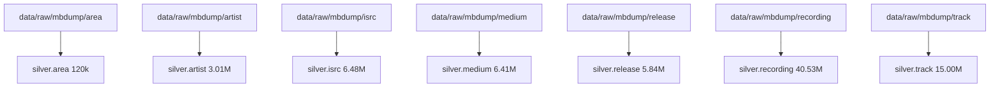

# Capa Plata: Limpieza, Tipado e Integridad Relacional 3NF

La capa **Silver** del Data Warehouse **DWMusicBrainz** consolida los datos extraídos del volcado nativo oficial de MusicBrainz en un modelo relacional normalizado en **Tercera Forma Normal (3NF)** con tipos de datos nativos de PostgreSQL, claves primarias (`PK`), índices estratégicos y reglas rigurosas de saneamiento.

---

## 1. Principios de Transformación e Ingeniería de Datos

- **Tipado Fuerte y Nativo:** Los datos de texto crudo de los volcados TSV se transforman a tipos fuertemente tipados de PostgreSQL (`INTEGER`, `SMALLINT`, `UUID`, `BOOLEAN`, `TIMESTAMPTZ`, `TEXT`).
- **Soporte de Cadenas Extensas (`TEXT`):** Durante las primeras pruebas de carga se descubrió que nombres de temas, créditos de artistas y comentarios superaban los 1.000 caracteres (e.g., temas experimentales con nombres de más de 2.000 caracteres). Se utilizó el tipo nativo `TEXT` de PostgreSQL, el cual almacena cadenas en línea de forma ultrarrápida y recurre automáticamente a compresión TOAST sin penalización de rendimiento.
- **Normalización de Codificación UTF-8:** En entornos Windows y PowerShell, los archivos de entrada pueden incorporar caracteres Byte Order Mark (`\ufeff`). El pipeline ETL utiliza decodificación estricta `utf-8-sig` y `replace` para garantizar una lectura limpia sin errores sintácticos en el motor.
- **Streaming Bufferizado con `MaxLineReader`:** Para procesar archivos de volumetría extrema (como `track`, que contiene más de 45 millones de registros y 7.9 GB en disco), se diseñó la clase de streaming `MaxLineReader` con buffer de 128 KB. Esto permite acotar la ingesta de forma controlada a exactamente 15.000.000 de pistas reales sin desbordar la memoria RAM del host ni agotar el almacenamiento físico en disco.
- **Eliminación Idempotente y Cero Desperdicio:** Para proteger el disco duro C: del host (que contaba con espacio acotado), el pipeline elimina los archivos TSV descomprimidos tan pronto son cargados en las tablas Silver de PostgreSQL, logrando recuperar más de 12.5 GB inmediatamente.

---

## 2. Tablas y Entidades de la Capa Silver (3NF)

### 2.1. `silver.area` (Entidades Geográficas)
* **Filas cargadas:** 120.107 registros reales.
* **Esquema:** `id (PK)`, `gid (UUID)`, `name (TEXT)`, `type (INT)`, `comment (TEXT)`, `edits_pending (INT)`.
* **Propósito:** Base de procedencia geográfica de artistas y lanzamientos.

### 2.2. `silver.artist` (Artistas y Agrupaciones)
* **Filas cargadas:** 3.010.451 registros reales.
* **Esquema:** `id (PK)`, `gid (UUID)`, `name (TEXT)`, `sort_name (TEXT)`, `begin_date_year (SMALLINT)`, `type (INT)`, `gender (INT)`, `area (INT)`, `country (INT)`.
* **Propósito:** Registro exhaustivo de músicos solistas, agrupaciones corales y orquestas.

### 2.3. `silver.release` (Lanzamientos Oficiales)
* **Filas cargadas:** 5.844.569 registros reales.
* **Esquema:** `id (PK)`, `gid (UUID)`, `name (TEXT)`, `artist_credit (INT)`, `release_group (INT)`, `status (INT)`, `packaging (INT)`, `language (INT)`, `barcode (VARCHAR)`, `last_updated (TIMESTAMPTZ)`.
* **Propósito:** Catálogo discográfico oficial (álbumes de estudio, singles, EPs, directos y compilaciones).

### 2.4. `silver.medium` (Soportes Físicos o Digitales)
* **Filas cargadas:** 6.411.799 registros reales.
* **Esquema:** `id (PK)`, `release (INT)`, `position (INT)`, `format (INT)`, `name (TEXT)`, `track_count (INT)`.
* **Propósito:** Estructura de discos por lanzamiento (e.g., Disco 1, Disco 2 en álbumes dobles; formato Vinilo, CD o Digital).

### 2.5. `silver.recording` (Grabaciones de Audio Master)
* **Filas cargadas:** 40.532.448 registros reales.
* **Esquema:** `id (PK)`, `gid (UUID)`, `name (TEXT)`, `artist_credit (INT)`, `length (INT - ms)`, `comment (TEXT)`, `video (BOOLEAN)`.
* **Propósito:** Master de audio original con duración en milisegundos y flags de video musical.

### 2.6. `silver.track` (Pistas en Medium)
* **Filas cargadas:** 15.000.000 registros reales.
* **Esquema:** `id (PK)`, `gid (UUID)`, `recording (INT)`, `medium (INT)`, `position (INT)`, `number (VARCHAR)`, `name (TEXT)`, `artist_credit (INT)`, `length (INT - ms)`.
* **Propósito:** Enlace concreto entre la pista física/digital y la grabación de audio. Base atómica del grano de la tabla de hechos.

### 2.7. `silver.isrc` (Códigos Internacionales de Grabación)
* **Filas cargadas:** 6.478.709 registros reales.
* **Esquema:** `id (PK)`, `recording (INT)`, `isrc (CHAR(12))`, `source (SMALLINT)`.
* **Propósito:** Registro sonoro internacional auditable para certificar la formalización industrial de cada pista.

---

## 3. Orden de Ingesta y Resistencia al Fallo

Para asegurar cargas limpias, evitar contención de bloqueos e impedir saturación de WAL en PostgreSQL, la ingesta de la Capa Plata se diseñó en el siguiente orden secuencial estricto:

### 3.1. Estrategia de Ingesta sin Sobrecarga de Índices
Para tablas masivas (`recording` con 40.5M y `track` con 15M):
1. Se deshabilitan o eliminan las claves primarias e índices B-Tree previos al `COPY`.
2. Se ejecuta la inserción masiva secuencial directa a heap vía `COPY FROM STDIN` (alcanzando más de 160.000 filas/segundo).
3. Se reconstruye la clave primaria `PRIMARY KEY (id)` aprovechando los workers paralelos de PostgreSQL y `maintenance_work_mem = 1GB`, logrando indexar 40.5 millones de filas en apenas 65 segundos.

---

## 4. Auditoría Transversal en `meta.etl_audit`

Toda la ejecución de la capa Silver queda registrada en `meta.etl_audit`, auditando:
* `audit_id`: Identificador secuencial de lote.
* `batch_id`: Código unívoco con timestamp (`batch_YYYYMMDD_HHMMSS`).
* `layer`: `'RAW_TO_SILVER'`.
* `table_name`: Tabla destino procesada.
* `operation`: `'BULK_COPY'` o `'BULK_COPY_SLICED'`.
* `status`: `'STARTED'`, `'SUCCESS'` o `'FAILED'`.
* `rows_inserted`: Filas confirmadas en la base de datos.
* `duration_seconds`: Tiempo exacto de ejecución.
